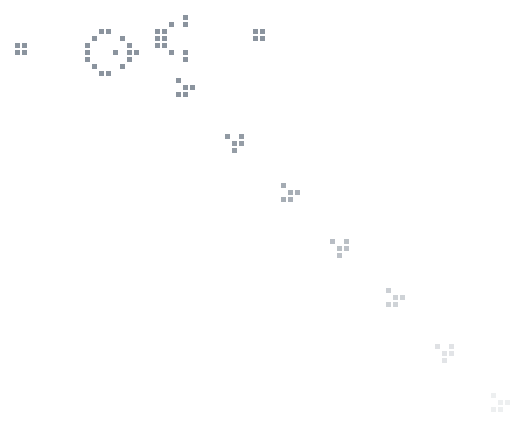
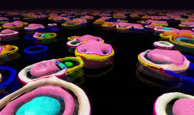
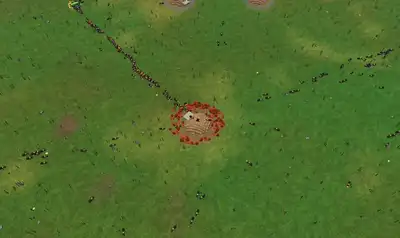
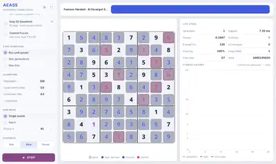
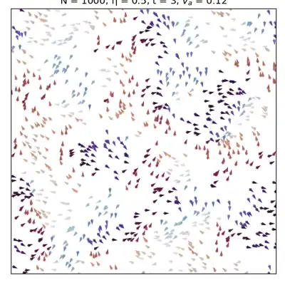
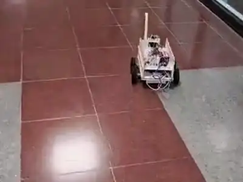

## Emre Ertürk

Bsc Computer Engineering · İzmir Institute of Technology 

Artificial life, evolutionary computation and robotics. Simulations run in the browser
(WebGL2) where possible; classic papers in the field are re-implemented to check their results.

I am interested in artificial life, swarm robotics , evolutionary robotics and etc.

evolutionary computation · artificial life · swarm intelligence · agent-based modelling · GPU / WebGL · mobile robotics · embedded systems

 

### Research projects

<table>
<tr>
<td width="220" valign="top"></td>
<td valign="top">

**[EvoMaxx: three chemicals that evolve visuals and music](https://github.com/EmreErturk-3/evomaxx)** · 2026 
An RGB reaction–diffusion world in which an eight-gene network, compiled to a GPU shader, grows
organisms that crawl, split and play their own music. The defaults were chosen by controlled
experiments on about 18,000 worlds, and 12 classic A-life papers are reproduced alongside it. 
[Live](https://emreerturk-3.github.io/evomaxx/) · [A-life reproductions (live)](https://emreerturk-3.github.io/evomaxx/reproductions/live/) · [Explainer](https://github.com/EmreErturk-3/evomaxx/blob/main/EXPLAINED.md) · WebGL2 · WebAudio · Python

</td>
</tr>
<tr>
<td width="220" valign="top"></td>
<td valign="top">

**[Slavemaker Swarm: an individual-based simulation of *Polyergus* slave raids](https://github.com/EmreErturk-3/slavemaker-swarm)** · 2026 
A 3-D agent-based model of slave-making ants. Pheromone-guided raid columns, brood theft, enslavement,
queen usurpation and slave rebellion are all modelled, and host defence and parasite strategy
coevolve with no explicit fitness function. 
[Live](https://emreerturk-3.github.io/slavemaker-swarm/) · [Report](https://github.com/EmreErturk-3/slavemaker-swarm/blob/main/docs/REPORT.md) · WebGL2 · JavaScript

</td>
</tr>
<tr>
<td width="220" valign="top"></td>
<td valign="top">

**[AEASS v3: Revisiting an Adaptive Evolutionary Algorithm for Solving Sudokus](https://github.com/EmreErturk-3/aeass)** · 2025, revised 2026 
A memetic algorithm (GA + Lamarckian min-conflicts local search + ILS escapes) on logic-reduced
domains. It solved and independently verified all 65,201 runs over 52,458 benchmark puzzles,
including AI Escargot and Easter Monster. 
[Paper](https://github.com/EmreErturk-3/aeass/blob/main/paper/AEASS_v3_paper.pdf) · [Live](https://emreerturk-3.github.io/aeass/) · Python · C · WebGL2

</td>
</tr>
<tr>
<td width="220" valign="top"></td>
<td valign="top">

**[Paper reproductions: swarm and evolutionary computation](https://github.com/EmreErturk-3/swarm-reproductions)** · 2026 
Classic papers re-implemented from the text alone and run again, reporting what did and did not
reproduce: BEECLUST Kilobot aggregation in ARGoS (Bodi et al. 2009), Vicsek flocking (1995),
NEAT on XOR (Stanley & Miikkulainen 2002) and Gray–Scott patterns (Pearson 1993). 
C · ARGoS · Python

</td>
</tr>
</table>

### Robotics

<table>
<tr>
<td width="220" valign="top"></td>
<td valign="top">

**[P.C.B: an indoor mobile robot for corridor navigation and secure delivery](https://github.com/EmreErturk-3/robotics/tree/main/pcb-delivery-robot)** · CENG 483 · 2026 
A low-budget delivery robot built through three prototypes, with an Arduino Mega for control and a
Jetson Nano for the mission. It navigates by servo-scanned ultrasound, holds its heading with
IMU-aided PID and starts and stops at ArUco markers. 
[Paper](https://github.com/EmreErturk-3/robotics/blob/main/pcb-delivery-robot/report.pdf) · [Videos](https://youtube.com/playlist?list=PLwDQJAClSxDNaZMpJzPJgvE02jZJuD9hk) · with H. N. Kömürcü, D. Karabacak, T. İyiarı

</td>
</tr>
<tr>
<td width="220" valign="top"></td>
<td valign="top">

**[PartyBot: a gesture-controlled mecanum robot](https://github.com/EmreErturk-3/robotics/tree/main/partybot)** · CENG 424 · 2026 
A sensor glove drives a mecanum-wheel platform over ESP-NOW, a peer-to-peer link between two
ESP32s. The robot strafes, plays music and shows expressions on a dot-matrix display. 
[Slides](https://github.com/EmreErturk-3/robotics/blob/main/partybot/presentation.pdf) · with T. Topcu, O. Kansoy, T. Yaraşlı

</td>
</tr>
</table>

### Other

[Acil Okey](https://github.com/EmreErturk-3/AcilOkeyApp-master) (React Native, HCI group project) ·
[Passport MRZ reader](https://github.com/EmreErturk-3/passport-ocr) ·
[WhatsApp assistant](https://github.com/EmreErturk-3/whatsapp-assistant-bot) ·
[Yemek Analiz](https://github.com/EmreErturk-3/yemek_app) ·
[RT top-50 scraper](https://github.com/EmreErturk-3/RT_top50_web_scraper)
